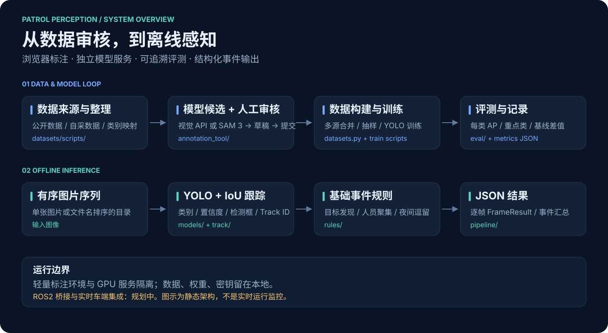
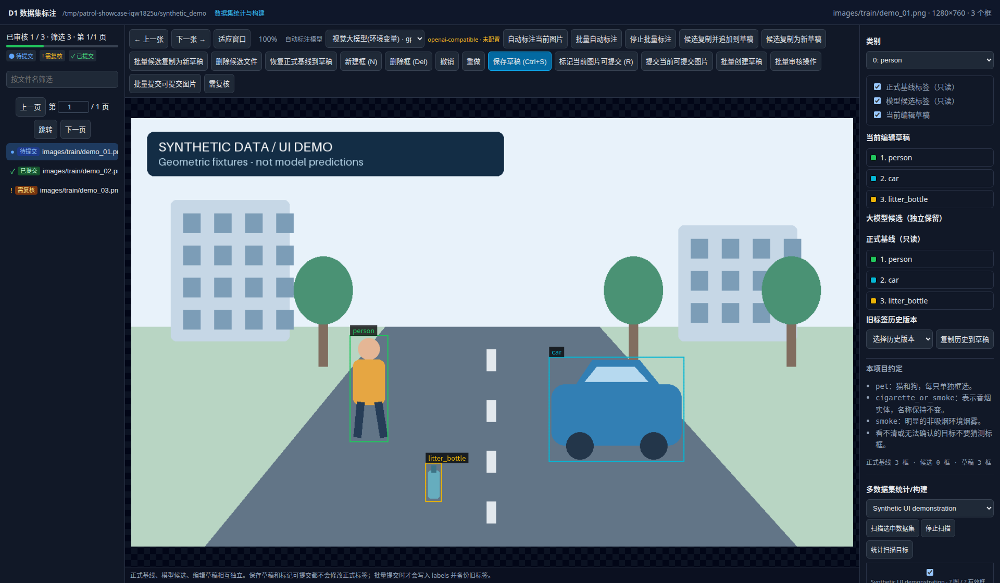
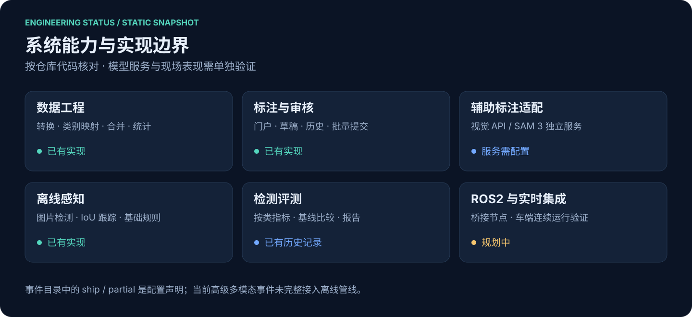
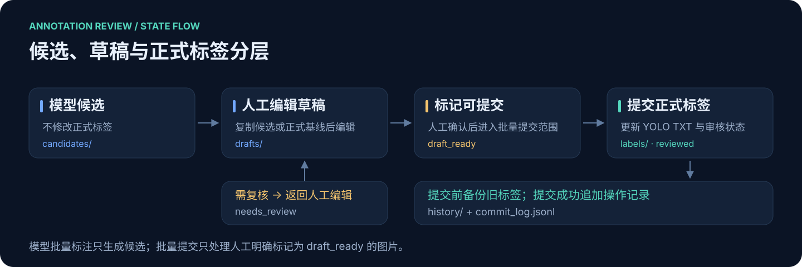
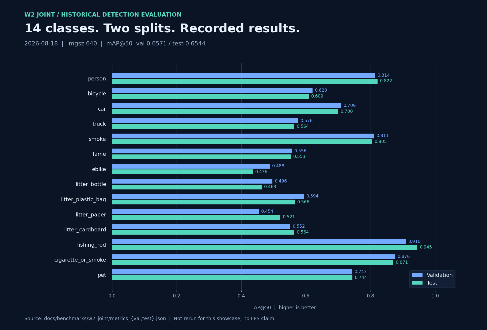

# Patrol Perception · 巡逻车视觉感知

[](https://github.com/zh-zehui/patrol-perception/actions/workflows/ci.yml)
[](docs/quickstart.md)

面向巡逻场景的视觉工程：**数据整理 → 模型辅助标注 → 人工审核 → YOLO 训练与评测 → 离线检测与事件输出**。

轻量浏览器标注工具与 GPU 模型服务分开运行；代码、配置与评测摘要在仓库中管理，图片、模型权重和服务密钥保留在本地。



## 能展示什么

| 模块 | 当前能力 | 入口 |
| --- | --- | --- |
| 标注门户 | 数据集登记、独立标注进程、模型配置与任务管理 | [annotation_tool](annotation_tool/README.md) |
| 人工审核 | 检测框编辑、候选与草稿分层、历史备份、批量提交 | [本地演示](#五分钟启动标注演示无需-gpu) |
| 辅助标注 | 视觉 API / 独立 SAM 3 服务生成候选，人工确认后提交 | [SAM 3 服务](annotation_tool/sam3_service/README.md) |
| 数据工程 | 下载清单、类别映射、合并、负样本、统计、数据集构建 | [datasets](datasets/README.md) |
| 检测评测 | 按类别 AP、重点类与底座类指标、基线差值、Markdown 报告 | [评测记录](docs/evaluation.md) |
| 离线感知 | 图片序列检测、IoU 跟踪、基础发现 / 聚集 / 夜间逗留规则、JSON 输出 | [运行说明](docs/quickstart.md) |

本仓库是研发与离线演示工程。ROS2 桥接、实时车端集成及部分高级事件仍待实现；`events_catalog.yaml` 中的 `ship/partial` 是配置声明，不能作为功能验收结论。当前规则范围见[系统状态](docs/status.md)。

## 五分钟启动标注演示（无需 GPU）

需要 Python 3.10+，在仓库根目录执行：

```bash
python -m venv .venv
source .venv/bin/activate
python -m pip install -e ./annotation_tool
python scripts/create_demo_dataset.py

d1-annotate --dataset data/demo_dataset \
  --classes annotation_tool/config/classes.yaml
```

打开 **<http://127.0.0.1:8765>**，即可编辑检测框、保存草稿、标记可提交并批量提交。演示脚本只生成几何图形样本，不使用实采图片、不下载权重、不调用外部 API。它用于体验操作流程，不能用于衡量模型精度。



多数据集门户启动方式：

```bash
cp annotation_tool/config/datasets_registry.example.yaml \
  annotation_tool/config/datasets_registry.yaml
# 按需修改注册表中的数据集路径；演示条目默认为 data/demo_dataset。
d1-annotate-portal \
  --registry annotation_tool/config/datasets_registry.yaml \
  --classes annotation_tool/config/classes.yaml \
  --host 127.0.0.1
```

从根目录运行时，示例注册表可直接找到演示集。标注服务没有登录认证，默认示例仅供本机访问；多人部署请阅读[标注工具说明](annotation_tool/README.md)。

## 系统状态与标注闭环





模型结果先进入候选层，人工编辑产生草稿。批量提交只处理人工标记为 `draft_ready` 的图片，覆盖正式标签前自动保留历史。详见[状态与边界](docs/status.md)。

数据集统计与构建界面见[演示截图](docs/assets/dataset-builder.png)，同样使用合成数据。

## 已有评测结果

以下为 **2026-08-18 的 W2 联合 14 类历史评测记录**，输入尺寸 640。数据集、权重与运行环境未随仓库发布；本次整理未重新运行 GPU 评测。

| 划分 | mAP@50 | mAP@50:95 |
| --- | ---: | ---: |
| Validation | 65.71% | 45.50% |
| Test | 65.44% | 45.14% |



指标来源、完整数值和复现限制见[评测说明](docs/evaluation.md)。这些是目标检测指标；事件级准确率、FPS 和车端实时性能尚未在此报告。

## 开发与仓库管理

```bash
python -m pip install -r requirements-dev.txt
python -m pytest
python scripts/check_publication.py
```

- Pull Request 自动执行 CPU 测试和公开内容检查，无需下载模型或配置 API Key。
- 提供问题模板、功能建议模板、PR 模板及 Dependabot 更新配置。
- 以 `main` 作为可展示分支，功能通过短分支和 PR 合入；发布时按 `v0.x.y` 标记可复现版本。
- 具体维护约定见 [CONTRIBUTING.md](CONTRIBUTING.md)；初次上传和 GitHub 设置见[发布说明](docs/github-publishing.md)。

## 目录导航

```text
annotation_tool/   浏览器标注、门户、候选服务与测试
config/            类别、事件、数据源、合并任务与评测配置
datasets/scripts/  数据下载、转换、合并、统计与预览
src/patrol_perception/
  models/          YOLO 检测适配器
  track/           IoU 跟踪
  rules/           已实现的基础事件规则
  pipeline/        离线运行与 JSON 落盘
  eval/            指标、基线比较与报告
scripts/           演示、训练、评测与仓库检查
docs/              架构、状态、运行说明与展示图片
tests/             感知与数据工程测试
.github/           CI、依赖更新和协作模板
```

全局类别目录是能力规划全集，当前 W2 模型和标注默认使用 14 类；加载其他权重时以该权重及数据集的类别定义为准，不要直接套用不同顺序的类别 ID。

## 数据与许可说明

仓库不分发模型权重、实采图片或第三方数据集。第三方代码、模型与数据的使用条件见其上游项目；当前仓库尚未指定独立开源许可证，公开展示不等于授予再分发或商用许可。
