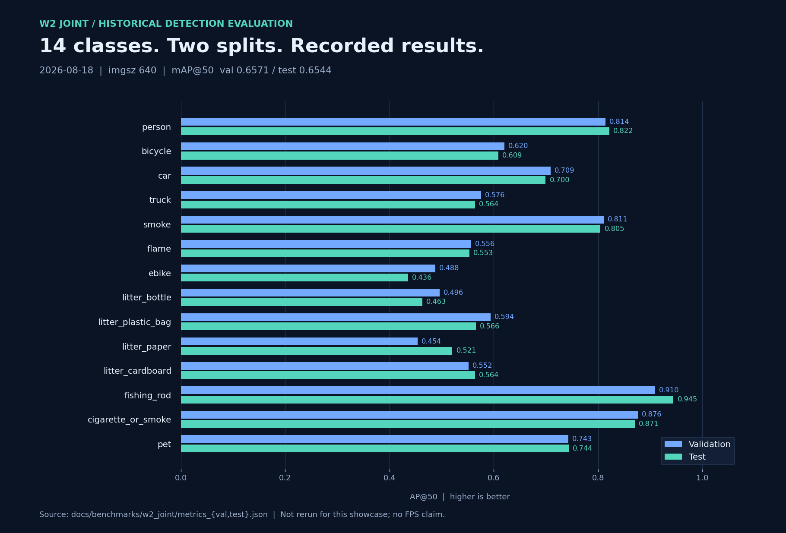

# W2 联合检测评测记录

本页展示已有历史结果。本次仓库整理没有重新训练或重新运行 GPU 评测。

| 项目 | 记录 |
| --- | --- |
| 原始运行目录名 | `w2_joint_20260818_171719` |
| 记录时间 | `2026-08-18T17:37:40.839562+00:00` |
| 输入尺寸 | 640 |
| 检测类别数 | 14 |
| 划分 | validation / test |
| 权重记录 | W2 联合训练的 `best.pt`，本仓库不分发 |
| 数据集记录 | `detect_w1_fire` 联合集；名称沿用 W1，但该次记录包含 W2 类别 |

| 划分 | mAP@50 | mAP@50:95 | 重点类 mAP@50 | 底座类 mAP@50 |
| --- | ---: | ---: | ---: | ---: |
| Validation | 0.657071 | 0.455023 | 0.647971 | 0.679822 |
| Test | 0.654372 | 0.451369 | 0.646717 | 0.673509 |

重点类与底座类定义见 [config/eval.yaml](../config/eval.yaml)。图中显示每类 AP@50，范围 0–1；它与 mAP@50:95 是不同指标。

## 数据来源

原始 `data/eval_runs/w2_joint_20260818_171719/` 中的以下两个文件原样复制到公开摘要目录，未修改数值：

- [metrics_val.json](benchmarks/w2_joint/metrics_val.json)
- [metrics_test.json](benchmarks/w2_joint/metrics_test.json)

[provenance.json](benchmarks/w2_joint/provenance.json) 保留运行标识、时间、输入尺寸与原始指标文件 SHA-256，去除个人绝对路径。

运行 `python scripts/generate_showcase.py` 可从这两个 JSON 重建展示图。这会重绘历史数值，不会重新测量模型。

## 复现边界

原始数据集、权重及完整环境锁定文件没有发布，已有记录也未保存全部数据集版本哈希、样本数或设备信息，因此本仓库只能复现图表，不能保证复现同一精度。不同训练波次的数据组成和类别数不同，未在此作直接提升对比。

没有在本次整理中确认独立采集批次划分或近重复泄漏审计；数值不代表真实巡逻环境中的泛化结论。事件级准确率、延迟和 FPS 未在此记录。
