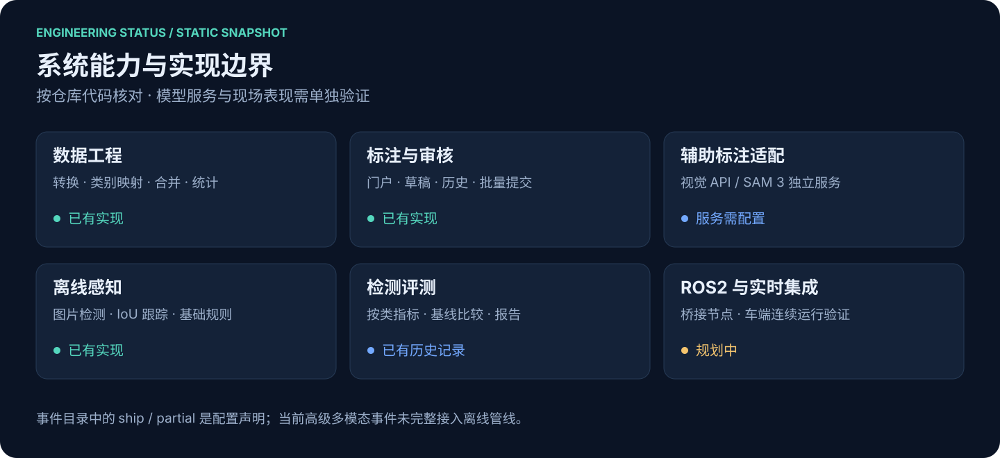
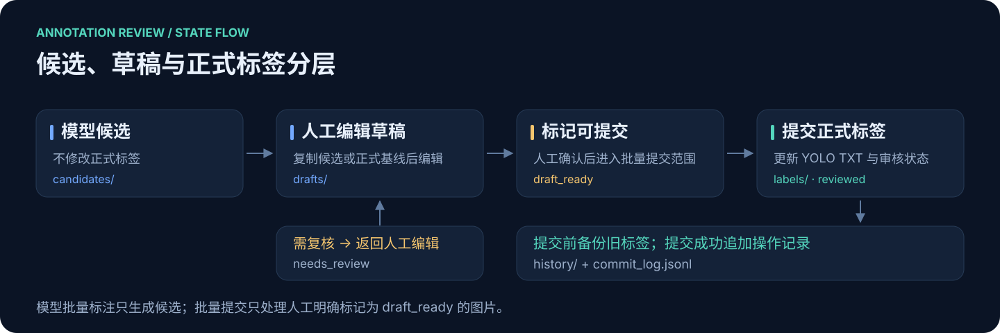

# 系统状态

此页面与状态图于 **2026-11-04** 按代码整理核对，是**静态工程状态**，不是在线服务监控。模块已实现表示存在代码和对应流程，不代表部署验收或实地精度达标。

| 模块 | 代码依据 | 状态及限制 |
| --- | --- | --- |
| 数据集整理 | `datasets/scripts/`、`annotation_tool/src/d1_annotation/datasets.py` | 下载、转换、合并、统计、构建；数据和许可另行管理 |
| 门户与审核编辑 | `annotation_tool/src/d1_annotation/` | 多数据集进程隔离、候选/草稿、备份与批量提交；无账户系统 |
| 模型辅助标注 | `autolabel.py`、`sam3_service/app.py` | 适配视觉 API 与 SAM 3；本次未调用外部模型 |
| 检测、跟踪与规则 | `src/patrol_perception/` | 图片序列离线流程；基础发现、聚集、亮度门控与帧数驻留规则 |
| 训练及评测 | `scripts/`、`src/patrol_perception/eval/` | 训练包装和标准评测；公开保留 W2 历史指标摘要 |
| ROS2 / 实时车端链路 | 尚无对应桥接模块 | 规划项；本仓库没有端到端车端运行证明 |
| 高级多模态事件 | 主要存在于事件目录配置 | 人脸、姿态、OCR、音频、区域等旁路未完整接入当前离线管线 |

## 事件目录与代码的区别

`config/events_catalog.yaml` 声明更广的业务目标与依赖。当前离线管线实际调用：

- `coco_discover_events`：自行车、小轿车、货车、宠物、瓶类垃圾发现；
- `crowd_events`：基于人员数阈值的聚集判断；
- `NightLoiteringRule`：亮度阈值与连续帧位置变化规则。

训练集中的烟雾、明火、电动车等检测类存在，不表示这些类别均已实现独立事件规则。事件输出与检测输出是不同层级。

## 审核状态流转

候选与正式标签分开保存。人工草稿保存在 `.d1_annotations/drafts/`；标为 `draft_ready` 后可批量提交，已有正式标签先进入 `history/`，成功提交记录写入 `commit_log.jsonl`。

同一数据集多人同时编辑同一张图仍可能发生提交冲突；当前隔离粒度主要是不同数据集进程。
